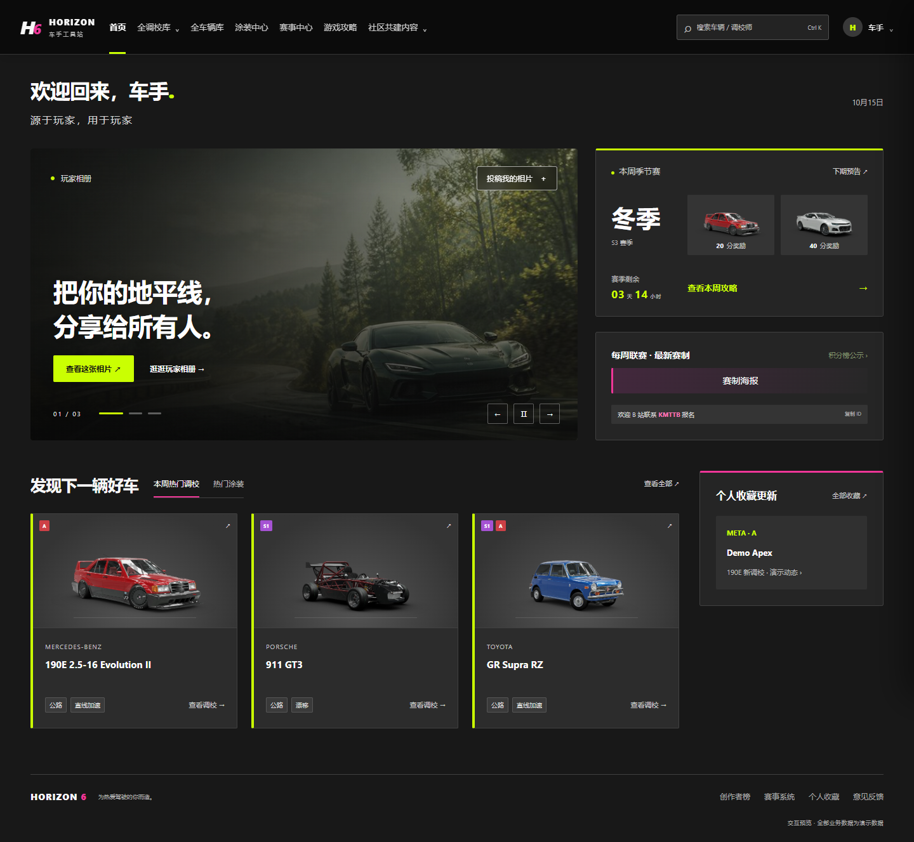

# HORIZON 6 · Web UI 预览

面向玩家的地平线 Web 界面原型。重新设计网页布局与视觉，保留小程序的功能板块及主要操作流程。

当前本地视觉参考 Forza 官方网站（https://forza.net/）：深灰背景、大幅摄影、粗体标题、黄绿主按钮及粉色强调。样式集中在 `forza-theme.css`，保留现有导航与演示交互；本地预览与 GitHub Pages 使用同一套静态文件。



## 运行

安装 Node.js 后，在此目录运行：

```sh
npm start
```

打开 http://127.0.0.1:8765/ 。启动预览无须安装 npm 依赖。也可使用其他静态文件服务器。

## 页面与交互

- 顶部深浅主题切换：默认深色，手动选择保存在本地，刷新及页面跳转后保留。布局和组件共用一份实现，颜色集中在 `forza-theme.css` 的深浅主题变量中。后续 UI 修改须同时适配并检查两个主题，维护约定见 `AGENTS.md`。

- 文案约定：不添加装饰性的英文副标题或无实际用途的小字；首页口号为「源于玩家，用于玩家」。品牌、车型、调校等级等实际信息保留。
- 顶部全局搜索：按车辆名、车厂或调校师名称搜索现有演示数据，结果按车辆和调校师分组。支持 Ctrl/Cmd+K、方向键选择、Enter 打开、Esc 收起；车辆结果直接展示全部调校。
- 全调校库下拉：线上推荐、漂移 / 直线加速，直接进入对应模式。
- 顶部品牌「车手工具站」兼作返回首页入口，不再重复显示「首页」按钮。独立入口为全调校库、全车辆库、涂装中心、赛事中心、游戏攻略及社区共创。
- 「社区共创」下拉包含蓝图推荐、相册和创作者排行榜；右上角车手入口打开个人档案。
- 导航按实际内容宽度测量：放得下时横向显示，放不下时收进左侧「导航」按钮，展开后纵向显示，内部分组可继续展开。窗口放大后自动恢复横向导航。
- 全局搜索始终与品牌、主题和账号处于最顶部同一行，不再单独换行。窄屏搜索结果面板相对视口定位，避免超出边界。
- 主导航和分组支持点击、方向键、Esc、点击外部及焦点离开收起；选择目的地后自动收起。`header-navigation.css` 和 `header-navigation.js` 维护自适应顶部导航，`tests/header.cjs` 覆盖 320–1920px 的两套主题与键盘交互。
- 涂装中心为预览占位页；玩家相册支持大图预览、本地选图与标题填写，投稿仅在当前页面会话中预览，不上传或公开发布。
- 首页参考指定网站的布局，保留顶部导航，不加入左侧栏：左侧相片轮播、中间赛季和赛事卡片、右侧仅保留个人收藏更新；首页分为两行：上方相片与赛季/赛事，下方纵向推荐卡片与个人收藏更新。标题、调校/涂装标签和查看全部同行，增加间距与留白，允许自然滚动。热门涂装目前为占位内容。轮播支持自动切换、暂停、前后切换与选图，减少动态效果设置下默认暂停。
- 全调校库：线上竞速与漂移/直线加速模式切换，品牌、等级、场景、驱动筛选，梯队分组。
- 车辆详情：查看匹配或全部调校、点赞、复制调校师 ID、收藏车辆。
- 车手档案：昵称编辑和返回首页入口。
- 季节赛：当期攻略、下期预告、奖励图预览。
- 车辆库、蓝图、游戏攻略、创作者榜、赛事与反馈提供演示页面。

首页、调校库和车辆详情为主要设计页面。高级车辆筛选与蓝图收藏仍是简化示范，本项目不是完整的 Web 产品迁移。

## 车辆功能进度

- 首页上下两行共用列宽：相册与推荐区左对齐，季节赛/赛事与个人中心同宽；个人中心有独立标题，与推荐区标题和内容起点对齐。推荐最多两行，1100px 及以下个人中心移至推荐上方，推荐只显示一行，多余作品通过「查看全部」进入完整列表。

- 全车辆库支持车辆名、品牌、调校师的多关键词搜索，品牌、等级、驱动、国家/地区和仅看已收藏筛选；支持按品牌/名称、车辆等级、调校数量排序。
- 全调校库支持关键词搜索、排序及现有用途筛选，卡片上的等级和场景只显示当前匹配的调校。
- 车辆详情支持返回原列表、复制详情链接，刷新或浏览器前进/后退会恢复车辆、调校模式及筛选上下文。非法车辆链接会返回车辆库。
- 个人收藏支持搜索、筛选和直接取消收藏；收藏保存在当前浏览器，不代表云端账号数据。本地收藏值损坏时会按空收藏打开，避免页面白屏。
- `storage.js` 处理可选的本地存储，`vehicle-functions.js` 实现车辆功能和可分享的 URL 状态；`tests/vehicles.cjs` 验证连续操作与异常场景。
- 本阶段仍使用 9 辆演示车辆，无正式 API、账号登录或跨设备同步。涂装、蓝图、攻略、赛事与投稿等其余模块仍按下方说明使用演示内容。

## 演示数据

所有车辆参数、调校、任务、赛季、创作者、蓝图与成绩均为演示数据。配图与示例车型不保证对应。没有正式云端连接或真实数据写入。昵称、车辆收藏和创作者关注保存在本机浏览器；点赞为临时状态。

### 首页个人收藏更新

- 调校 / 涂装独立切换，默认显示当前分类最新 3 条；超过 3 条时可展开全部或收起，切换分类恢复 3 条。
- 取当前时间向前滚动 7 × 24 小时内的作品更新时间（包含已有作品修改），按更新时间倒序。以作品 ID 去重，收藏车辆或关注创作者任一命中即可显示，同一作品不会因同时命中两者而重复。
- 关注以创作者 ID 为唯一锚点，统一覆盖该创作者的调校和涂装；关注可在创作者主页及涂装演示详情中切换。
- 每条调校更新显示车辆图片、车辆名称、等级 / 适用场景 / 强度标签，以及创作者和更新时间。点击直接打开该车辆的匹配调校。涂装显示车辆与作品名称，使用独立演示详情，不添加调校等级等无关标签。
- 当前演示时间相对浏览器当日 UTC 零点生成，仅用于操作预览；未来接入后端时需使用真实作品发布时间及更新时间。涂装图片和分享码尚未接入，车辆图片明确标注为演示配图。
- `activity-model.js` 提供纯筛选规则；`home-updates.js` 连接收藏、统一关注、展开与切换。`tests/activity.cjs` 覆盖 7 天边界、重复命中、修改时间、持久化和两套主题。

## 验证

```sh
npm install
npm test
```

运行测试前先启动本地预览。测试使用本机 Microsoft Edge 无头浏览器，覆盖昵称修改、筛选联动、模式切换、车辆详情、收藏、点赞、赛季预告和图片预览，并检查 390px 页面横向溢出。

通过 `PREVIEW_URL` 环境变量可指定其他测试地址。测试截图生成在 `tests/` 下；交付截图保存在 `docs/`。

本项目没有附加许可证声明，图片和品牌素材沿用原项目，仅用于此次 UI 原型展示。
